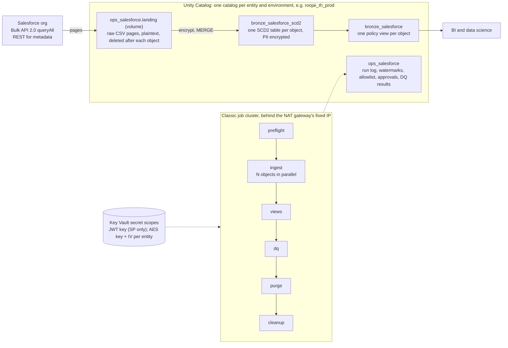

# Architecture

How the solution works, end to end. The agreed requirements and design are in `shared_folder/salesforce-ingestion-design.md` (IDs FR-xx, NFR-xx, D-xx). This bundle implements that design with the departures listed in [decision-log.md](decision-log.md) (IDs B-xx).

## Overview

- One **job per catalog**: `roojai_th_uat`, `roojai_th_prod`, and later `kumka_th_*`. A catalog holds exactly one Salesforce org (D-10, D-16).
- Every task runs on **one classic job cluster**: Databricks Runtime 18 LTS with Photon, a single node (`Standard_D4ds_v5`), single-user mode as the environment's service principal, local disk encryption. Salesforce only accepts the NAT gateway's IP, and serverless compute can't use it (D-03, D-04).
- Code is one Python package, `sf_ingest`, built as a wheel. Each job task is a subcommand of its `sf_ingest` entry point (`src/sf_ingest/tasks.py`).

## Jobs

| Job (`resources/`) | Schedule | Tasks | Purpose |
| --- | --- | --- | --- |
| `sf_nightly_roojai` | 00:30 Asia/Bangkok, paused until seeded | preflight → ingest → views → dq → purge → cleanup | The nightly load |
| `sf_backfill_roojai` | on demand | preflight → backfill → views → cleanup | Fill newly approved fields on existing records |
| `sf_seed_roojai` | on demand, once | preflight → seed → views | Initial load from `backup_salesforce`, the clone of the Synapse tables |
| `sf_rotate_roojai` | on demand | preflight → rotate → purge | Re-encrypt every PII value with a new key (B-27) |

Table maintenance (`OPTIMIZE`, `VACUUM`, statistics) is left to **predictive optimization**, which preflight enables on the SCD2 and ops schemas; there is no maintenance job. The purge task runs REORG and VACUUM itself on tables whose PII was rewritten in place (B-21).

The jobs read the configuration packaged in the wheel (`sf_ingest/_config`), not the workspace files, so it always matches the code deployed with it. The bundle deploys into the service principal's workspace folder (B-29).

All jobs have `max_concurrent_runs: 1`, email `alert_email` on failure, and give `sf_operators_<catalog>` CAN_MANAGE_RUN. Tasks after `ingest` (and `backfill`) run with `run_if: ALL_DONE`, so views, checks, purge and cleanup happen even when objects fail.

Every task has a `timeout_seconds` (B-20): `long_task_timeout_seconds` (6 hours) for ingest, backfill, seed and rotate, 1 hour for the others. The timeouts are per task, not per job, so a timed-out ingest still lets views, dq and cleanup run, and the landing files are deleted. Within ingest, the Bulk client aborts a query job still running after 3 hours (`bulk.MAX_JOB_WAIT_SECONDS`), which fails only that object.

### preflight
1. Creates the schemas, ops tables (adding columns a newer version introduced), landing volume and the `decrypt_pii` / `decrypt_pii_at` functions if missing. Grants the four groups of `entities.yml` `access` (B-29): readers on the views, history readers on the SCD2 tables, operators on `ops_salesforce`, `pii_readers_<catalog>` EXECUTE on the functions. Enables predictive optimization on `bronze_salesforce_scd2` and `ops_salesforce`; deletes `run_plan` rows older than 30 days.
2. Deletes landing folders older than 12 hours, so a cancelled run's plaintext files go now (B-34). Raises `object_orphaned` for SCD2 tables and views of objects not in the config (B-30).
3. Seeds `ops_salesforce.field_allowlist` from `config/seed/<entity>_fields_allowlist.csv`. It only inserts missing rows, never overwriting run-time changes.
4. Applies the decisions of `config/approvals/<entity>.yml` to the allowlist, and marks the `pending` rows they answer in `field_approval` (B-28).
5. Authenticates (JWT) and records the certificate's expiry; warns 30 days ahead.
6. Calls `describe` on every configured, unretired object (8 in parallel), then decides tonight's field list per object (`metadata.plan_fields`):
   - an allowed field (`allowed = 1`) is queried; an excluded field (`allowed = 0`) is never queried or reported
   - `IsDeleted` and `LastModifiedById` are always queried when the object has them, whatever the allowlist says: delete and archival detection read them
   - an unknown field on an `auto-add` object is added to the allowlist and queried tonight. No such object holds PII: config validation requires `require-approval` on every object with `encrypted_fields` or `conditional_encryption`
   - an unknown field on a `require-approval` object is recorded as `pending` and left out
   - compound (`address`, `location`) and `base64` fields are skipped
   - a PII field (`encrypted_fields`, conditional columns) that `describe` doesn't return fails the object: a typo, an undeployed field or field-level security (B-26)
   - an allowed field `describe` doesn't return (removed, not deployed, hidden) raises `field_removed` every night, the first run included, until it is described again or rejected in `config/approvals`; its column stays, null from then on. A changed type, precision or scale raises `field_retyped`; the load then widens the column or fails (B-32).
7. Writes the plan to `ops_salesforce.run_plan` (keyed by run ID) and the describe output to `ops_salesforce.object_schema`.

One object never fails preflight for the others (B-19). An object whose `describe` returns 404 gets no plan and a `preflight` / `skipped` event in UAT, or when it is paused in that environment. In PROD an unpaused one is `failed`, because a lost object permission looks the same (B-23). Any other describe error, or a plan that lacks `Id` or the watermark column, gives a `preflight` / `failed` event with the error. Both raise an `object_planned` warning, except a missing object paused in that environment, and the object keeps its previous `object_schema` snapshot. Ingest reports these objects without running them; a failed one fails the ingest task at the end, so the job alerts. Only setup and authentication errors fail preflight itself.

### ingest
Runs every configured object (or the `objects` parameter's subset) in a thread pool, `workers` at a time (default 4, the node's cores). Objects are ordered by their average duration over the last 14 days, longest first; objects with no history go first. Each worker thread has its own Salesforce session and its own Spark FAIR scheduler pool.

Skipped:
- objects paused in this environment (`paused`), unless named in `objects`
- retired objects (`retired: true`)
- objects that already finished in this job run (a repair).

Per object (`tasks.ingest_object`):

0. **Seed guard.** An object with no watermark whose `backup_salesforce` table holds rows but whose SCD2 table is empty fails: the seed must run first (B-34).

1. **Extract** (`extract.py`, `bulk.py`). One Bulk API 2.0 `queryAll` job selecting tonight's fields:
   - `queryAll` also returns records in the recycle bin, with `IsDeleted = true`.
   - WHERE clause: the object's `soql_filter` if any, then, for incremental objects, `watermark > stored watermark − 1 hour` and `watermark <= now`. Full loads and full reloads have no watermark condition. A full reload of an object with `split_full_reload` runs yearly `CreatedDate` ranges, 4 at a time.
   - Each result page (`bulk_page_size` records) streams to `/Volumes/<catalog>/ops_salesforce/landing/<object>/<run_id>/page_<n>.csv` exactly as Salesforce returns it, so memory stays flat.
   - Retries: a page whose download drops is fetched again by its locator; 429 and 5xx responses back off and retry up to 5 attempts; a 401 re-authenticates once. The job-creating POST is retried only on a connect timeout or 429, so a retry never leaves a duplicate job (B-34).
   - Completeness: a job whose downloaded records differ from its `numberRecordsProcessed` fails the object before the load (B-35).
   - `rewrite` objects are extracted in full, like `full_reload` (B-33).
   - Objects configured `api: rest`, and objects the Bulk API rejects as unsupported, use REST `queryAll` and land the same CSV format.
   - A `SELECT COUNT()` with the same WHERE clause is recorded for the reconciliation check.
2. **Load** (`scd2.load_object`), detailed in [SCD2 tables](#scd2-tables). On an existing table it first refuses an outdated PII key (B-27), applies PII config changes to every version ([PII encryption](#pii-encryption)), and fits the columns to tonight's types (B-32); these steps run even when nothing was extracted. It reads the pages as strings and checks that every value fits its column type without rounding, else the object fails before anything is written. Then it dedupes per `Id`, flags deletes and archivals, encrypts PII, casts, hashes the stored values and MERGEs. After the MERGE commits, the watermark advances to the highest landed watermark (UTC) if that is later than the stored one.
3. **Hard deletes.** `load_type: full` objects (User, GroupMember): current records absent from tonight's complete extract get a new version flagged `_is_deleted` and `_is_hard_deleted`. Incremental objects, every `reconcile.every_days` (B-25): an Id-only `queryAll` extract, recycle bin included, flags the current records it lacks the same way and restores flagged ones that are back. An empty extract fails the object instead of flagging everything, unless the table has no current record either (or, for an incremental object, `reconcile.max_deleted_share` is 1); so does one that would flag more than `reconcile.max_deleted_share` of an incremental object's current records, and more than 10 records (`deletes.SHARE_GUARD_FLOOR`): 10 or fewer missing records are always flagged. A `soql_filter` applies to the current records too, as Spark SQL; when it doesn't parse as Spark SQL, the check is skipped.
4. The object's landing folder is deleted, whatever happened.

Every step appends to `ops_salesforce.run_events`; a final `ingest` event marks the object done. A failed object is logged and the others continue; the task fails at the end if any object failed, so the job's failure email fires.

### views
Recreates a view only when its SQL changed (hash kept in `ops_salesforce.view_state`), for example after a new column or a config change.

### dq
Writes results to `ops_salesforce.dq_results`. The table checks cover the rows the run wrote; every row on Sundays (Bangkok), with the `dq_full` parameter, and for objects whose PII was rewritten in place that night (B-37). A failed **critical** check fails the task, and with it the job:

| Check | Severity | Rule |
| --- | --- | --- |
| `one_current_row_per_id` | critical | No `Id` has two current versions |
| `pii_is_ciphertext` | critical | Every non-null value of every PII column (under its rule) decodes from base64 to whole AES blocks |
| `count_matches_soql` | warning | Rows extracted = `COUNT()` for the same window |
| `watermark_advanced` | warning | An incremental object that wrote versions advanced its watermark |
| `object_freshness` | warning | Every unpaused, unretired object had a successful ingest in the last `freshness_hours` (B-23) |
| `new_field_pending_approval` | warning | A field awaits approval (daily digest) |
| Written by other tasks | warning | `new_field_auto_added`, `field_removed`, `field_retyped`, `certificate_expiry`, `object_planned`, `object_orphaned`, `setup` (preflight); `pii_log_purged` (purge); `history_field_unmapped` (dq, weekly); `landing_volume_empty` (cleanup); `seed_count` (seed) |
| `pii_history_purged` (purge) | critical | After a purge's VACUUM, no data file of the version before an in-place PII rewrite is left in storage |

Two Databricks SQL alerts read `dq_results` (`resources/sf_ops.alerts.yml`): warnings of the last 24 hours at 07:00 Bangkok to `alert_email`, and the new-fields digest at 08:00 to `data_owner_email`.

### purge
Removes the history that in-place PII rewrites left behind (B-21), for every object with a request in `ops_salesforce.pii_purge`:
1. First night (`requested`): `REORG TABLE … APPLY (PURGE)` rewrites the files whose plaintext rows a deletion vector only masks. The data files the table had before the rewrite (recorded with the request, so no time travel is needed) that it no longer uses are recorded in `pii_purge.files`. The table gets a 12-hour file retention (`tasks.PURGE_FILE_RETENTION`), a one-day log retention and a checkpoint at every commit. State `reorged`.
2. Next night, 12 hours later at least: `VACUUM` deletes the files no longer in the table, then `VACUUM … DRY RUN` must list none of the recorded files (`pii_history_purged`, critical). State `files_purged`. The retention is never 0: VACUUM would also delete the files a concurrent writer (a backfill, the seed) hasn't committed yet, and corrupt the table.
3. Later nights: one commit, so the checkpoint written at it deletes the expired log commits, which hold per-file min/max statistics of the old files. Once the history starts after the purge, the default retentions come back (`pii_log_purged`; a warning after 4 days). State `done`.

A rewrite while a purge is under way (another PII change, a backfill) sends it back to step 1 from the rewrite's version; files recorded so far stay on the list. A rewrite requests its purge before it starts and again once it has committed, and every step records when it read the state it acted on, so a step or REORG that began before another job's rewrite never counts as covering it. Time travel on a purged table reaches back 12 hours until step 3 ends.

Copies outside the table (storage soft delete, clones, `backup_salesforce`) are outside its reach: see runbook §5.15.

### cleanup
Deletes this run's landing folders, plus any folder older than 12 hours (a run whose cleanup never ran; preflight deletes those too). Younger folders of other runs (a backfill running alongside) stay. Leftover files of this run or stale ones fail the `landing_volume_empty` check.

## Data model

Per catalog:

| Schema | Contents |
| --- | --- |
| `bronze_salesforce_scd2` | One table per object, named after the API name in lower case (`account`, `claim__c`). Every version of every record |
| `bronze_salesforce` | One view per object, same name: current versions with the object's policies applied |
| `ops_salesforce` | Control tables, the landing volume, `decrypt_pii` and `decrypt_pii_at` |

### SCD2 tables
Columns: every queried field, then:

| Column | Meaning |
| --- | --- |
| `_valid_from` | Start of the version: the record's watermark value (`SystemModstamp`) in Bangkok time |
| `_valid_to` | Start of the next version; null while current |
| `_is_current` | The latest version |
| `_is_deleted`, `_deleted_at` | Soft-deleted in Salesforce, or (User, GroupMember) missing from the full extract |
| `_is_archived`, `_archived_at` | Deleted by an archival user (`archival_user_ids`): archived, not deleted (D-23) |
| `_is_hard_deleted` | Missing from Salesforce altogether, recycle bin included (a full load, or the hard-delete check, B-25); `_is_deleted` is set too |
| `_row_hash` | SHA-256 of the tracked fields as stored: typed values, PII as ciphertext (B-21) |
| `_run_id`, `_extracted_at`, `_page_no` | Job run that wrote the version, page time (Bangkok) and page number |
| `_pii_key_version` | Key version the row's PII was encrypted with |

Rules:
- **When a new version is written.** An incoming record becomes a new version only if it is a new `Id`, or its watermark is newer than the current version's and its hash differs. The hash excludes `hash_exclude` fields (default `SystemModstamp`, `LastViewedDate`, `LastReferencedDate`). So replays, the 1-hour overlap and full reloads write nothing for unchanged records (NFR-05). Within one extract the latest row per `Id` wins. A second change within the same `SystemModstamp` second as the stored version isn't newer, so it is dropped as a replay (rare).
- **Hard deletes undo themselves.** A record flagged as hard-deleted that is back in a later extract (or in the next hard-delete check) becomes current again, starting that night.
- **Corrections.** A `rewrite` run writes a version, starting that night, for a record whose stored values differ from Salesforce's at an unchanged watermark (B-33).
- **Deletes and archivals.**
  - A record returned with `IsDeleted = true` is archived when its `LastModifiedById` is an archival user, and soft-deleted otherwise.
  - Objects without `LastModifiedById` (feeds, `*History`, ProcessInstanceWorkitem) always count as soft-deleted.
  - An undelete arrives as a new version with both flags false.
- **Types.** Columns take the type `describe` reports:

  | Salesforce type | Column type |
  | --- | --- |
  | boolean | BOOLEAN |
  | int / long | INT / BIGINT |
  | double, currency, percent | `DECIMAL(precision, scale)`, else DOUBLE |
  | date | DATE |
  | datetime | TIMESTAMP_NTZ |
  | everything else, and every PII column | STRING |

  A value that doesn't fit its type, or that a decimal cast would round, fails the object, with counts per column and no values.
- **Type changes** (B-32). A column takes a field's new type when Delta type widening can: a decimal with more digits or decimals, int to bigint. It keeps its type when that already holds the values (a wider decimal, STRING). Any other change fails the object: reset it (runbook §5.9).
- **New fields** are added with `ALTER TABLE ADD COLUMNS`. Older versions hold null.
- **Table settings.** Tables are liquid-clustered on `Id` with deletion vectors.

`*History` objects (name ends in `History`) are **append-only** (FR-08). Their tables:
- hold the business fields plus `_run_id`, `_extracted_at`, `_page_no` and `_pii_key_version`
- only receive new `Id`s: a stored row is never updated, so a row Salesforce later marks `IsDeleted = true` keeps `IsDeleted = false` and stays in the view, `delete_policy: delete` included
- keep history Salesforce itself purges after its retention period.

### Timestamps
- Every Salesforce `datetime` is stored in **Bangkok time** (UTC + 7, no daylight saving) as `TIMESTAMP_NTZ`, which reads the same in any session time zone (FR-13, D-24). Date-only fields are not shifted.
- In `*History` tables, `OldValue` and `NewValue` are text. When `DataType = 'DateTime'` they are shifted too, written as `yyyy-MM-ddTHH:mm:ss.SSS` without the trailing `Z`.
- **Watermarks stay in UTC**, taken from the raw landed value, because SOQL compares in UTC.

### Policy views
`bronze_salesforce.<object>` returns the current versions with the business columns only; the SCD2 columns (`_is_deleted`, `_valid_from`, ...) stay in `bronze_salesforce_scd2`. Filters:

| Setting | Effect |
| --- | --- |
| `delete_policy: retain` (default) | Soft-deleted and archived records shown, with Salesforce's `IsDeleted = true`; `LastModifiedById` tells archivals apart |
| `delete_policy: delete` | Soft-deleted records hidden; archived ones still shown |
| any object | Hard-deleted records (`_is_hard_deleted`, gone from Salesforce) hidden (B-25) |
| `load_type: full` | Every flagged-deleted record hidden |
| `include_created_today: false` (default) | Records created on or after the Bangkok date of the object's latest successful ingest hidden, so the view stops at the end of the last complete day, even after a failed night (B-36) |
| `retired: true` | No view: it is dropped (B-30) |
| `view_filter` | Extra SQL condition |

On `*History` views, `delete_policy: delete` hides rows stored with `IsDeleted = true` (a row deleted after it was stored isn't, see above). Consumers who need history query `bronze_salesforce_scd2` directly.

## PII encryption

- **Format.** `base64(aes_encrypt(value, key, 'CBC', 'PKCS', iv))` with a static IV, so identical values give identical ciphertext and joins and counts work on encrypted columns (D-07). Spark's native format, under a new key (B-13):
  - the key is 32 random bytes (AES-256) and the IV 16 random bytes, both stored base64 in the secret scope
  - the stored value keeps the 16-byte IV that Spark puts in front, so `aes_decrypt` needs no IV argument
  - no base64 line breaks (`base64_line_breaks: false`, pinned through `spark.sql.chunkBase64String.enabled`).

  All crypto SQL comes from `encrypt.CipherSpec`. It reads the key and IV with `secret()` inside the expression, so they never appear as literals in query plans. The key and IV live in the entity's PII scope (`pii_secret_scopes`), apart from the Salesforce JWT secrets (B-22).
- **What is encrypted.** All of this lives in `config/objects/<entity>.yml` (D-20):
  - `encrypted_fields` (31 fields on 11 objects)
  - `conditional_encryption`: Account `Name`, `FirstName`, `LastName` for person accounts, except one Id. The rule is evaluated on plaintext before anything is encrypted, and no column it reads can be PII (B-26).
  - `history_encryption`: `OldValue`/`NewValue` of a `*History` object when `Field` is listed, or is a PII field of the parent object (B-21). AccountHistory lists five fields, Thai_Identification_Number__c among them; Claim__History, Payments__History and the others inherit their parent's fields. `Field` matches case-insensitively, and through `encrypt.HISTORY_FIELD_ALIASES` (AccountHistory records `Name` as `TextName`); the weekly `history_field_unmapped` warning lists `Field` values that match no field of the parent.
  - Config validation refuses encrypting `Id`, the watermark, `CreatedDate`, `IsDeleted` and `LastModifiedById`; preflight fails an object whose PII fields Salesforce doesn't describe (B-26).
- **When.** Values are encrypted during the load, before the MERGE, so in the pipeline's own tables plaintext exists only in the landing files. Outside them: `backup_salesforce` holds plaintext of every field Synapse didn't encrypt (B-31's fields and the `*History` values of inherited PII fields included) until it is dropped (runbook §5.13), and storage-level copies may keep deleted files (Q14). Logs carry counts and IDs, never values. The row hash covers the stored ciphertext, never plaintext (B-21).
- **A field added to the PII config later.** Its existing values are encrypted in every version at the next run, even a run with nothing extracted, exactly once: tracked in `ops_salesforce.encryption_state` and tagged in the Delta commit. A non-STRING column becomes a STRING of ciphertext; the text encrypted is what Bulk CSV gives, so it matches later loads (B-24). A changed `when` rule is a new key (`encrypt.rule_key`, the rule's hash): the next run encrypts the plaintext rows it now covers in every version; rows only the old rule covered keep their ciphertext.
- **A field removed from the PII config.** Listed in the object's `decrypt_fields`, its values are decrypted in every version and the column goes back to its type; not listed, the object fails rather than mix ciphertext and plaintext in one column (B-24).
- **Nothing recoverable left behind.** Each in-place rewrite queues the [purge](#purge) of the table's history (B-21).
- **Key rotation.** `sf_rotate_<entity>` re-encrypts every value from `pii.previous_keys` to the current key; the nightly load refuses objects still on an older key (B-27).
- **Decrypt.** `ops_salesforce.decrypt_pii(value)` is a UC SQL function, with the current key. `decrypt_pii_at(value, _pii_key_version)` uses the key of the row's version, so it also reads rows a pending rotation hasn't re-encrypted yet (B-27). `_pii_key_version` is only in the SCD2 tables, not the views: during a rotation, rows under the old key can be decrypted from `bronze_salesforce_scd2` only, by members of the history readers. Only `pii_readers_<catalog>`, which also needs READ on the entity's PII scope (not the Salesforce one), can execute them (FR-11).
- **Accepted trade-offs (design).** Deterministic CBC with a static IV reveals equal values and shares no integrity check. Plaintext exists briefly in landing files. The grants give them to no one but the service principal; catalog owners and metastore admins can still read them (Q14).

## Authentication and network

- **JWT.** OAuth 2.0 JWT bearer flow against one Salesforce External Client App per org, through `simple-salesforce` (D-05, D-21). The private key secret holds either a PEM key, optionally followed by its certificate, or a base64 PFX with an optional password secret. The Bulk client reuses the access token and re-authenticates on 401.
- **Network.** Every call leaves through the workspace's NAT gateway (NFR-01). The integration user's profile only accepts that IP.

## Operations data (`ops_salesforce`)

| Table or view | Content |
| --- | --- |
| `run_events` | Append-only events per run, object and stage (`preflight`, `extract`, `load`, `deletes`, `reconcile`, `ingest`, `backfill`, `rotate`), with counts, Bulk job IDs, watermarks and errors |
| `run_log` (view) | One row per run and object. Status is the latest event's (a repaired object reads `succeeded`); `error_message` is the last error |
| `watermark_history`, `watermarks` (view) | Append-only UTC watermarks; the view takes the maximum, so a watermark never moves back |
| `field_allowlist` | Fields per object with `allowed` 1/0 and their source (`seed`, `auto-add`, `approval`) |
| `field_approval` | New fields awaiting a decision (`pending` / `approved` / `rejected`) |
| `object_schema` | Latest describe output |
| `object_config` | Snapshot of the object config used by the latest preflight |
| `run_plan` | Fields queried per run and object |
| `encryption_state` | Append-only: per object and PII key, `encrypted` or `decrypted` and the key version (B-24, B-27) |
| `pii_purge` | Append-only purge requests and their progress: `requested`, `reorged` (with the data `files` to delete), `files_purged`, `done` (B-21) |
| `view_state` | Hash of each view's SQL |
| `dq_results` | Every check result |
| `certificate` | JWT certificate expiry per run |
| `landing` (volume) | Raw pages during a run |

Worker threads only append to these tables, so parallel objects never conflict on a MERGE.

The ops dashboard (`dashboards/sf_ops.lvdash.json`) shows each run's finish time, duration, failed objects and the latest run per object.

## Initial load from `backup_salesforce`

The Synapse tables are deep-cloned by hand into `<catalog>.backup_salesforce`, one table (or view) per object named like its SCD2 table (`account`). `sf_seed_roojai` (`seed.py`) then, per object:
1. Reads the backup table and matches its columns to tonight's fields by name, case-insensitively. Fields missing in the backup load as null; an object without a backup table is skipped, and its first nightly run loads it in full.
2. Turns empty strings into null, as the nightly load does. Decrypts PII under each rule with the **legacy key** (`pii.legacy`: the Synapse and salesforce_dab key). Both stored forms are read: with or without the IV prefix, with or without line breaks. Values that aren't ciphertext are taken as plaintext. Ciphertext the legacy key can't read fails the object, with counts per column.
3. Casts to the column types. Backup timestamps are already in Bangkok time and are not shifted; a value that doesn't fit fails the object with counts.
4. Writes each record as its first SCD2 version (flags, PII encrypted with the current key, the hash of the stored values exactly as the nightly load computes it, B-38), or appends `*History` rows. It refuses to load into a non-empty table.
5. Seeds each watermark at the highest backup value minus 7 hours (back to UTC), and writes a `seed_count` check per object.

The first nightly run must follow within 15 days, while Salesforce's recycle bin still holds the deletes made in between.
