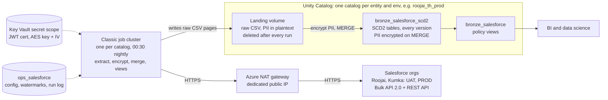

# Salesforce Ingestion on Databricks — Requirements & Target Design

Oct 25, 2026 · @Romain

## Purpose and scope

A custom Python job extracts Salesforce Sales Cloud data for two entities, Roojai and Kumka (Thailand), every night at 00:30 Bangkok time. It lands raw files, merges them into SCD2 tables in Unity Catalog on Azure Databricks, and publishes views that apply each object's policies. All decisions were agreed on 25 Oct 2026.

**In scope**

- Standard and custom objects from the Roojai and Kumka orgs, UAT and PROD
- `*History` objects (field history tracking)
- Migration of the existing Azure Synapse tables as the initial load
- SCD2 history, per-object view policies, deterministic PII encryption
- Orchestration and deployment with Databricks Asset Bundles

**Out of scope**

- Attachments, files and other binary content
- Near-real-time or streaming ingestion
- Writing data back to Salesforce
- Models built downstream of the views (assumed owned by BI and data science)

## Context

The largest objects hold tens of millions of rows and hundreds of fields, so extraction must page through results and never hold a whole object in memory.

| Area | Current state |
| --- | --- |
| Entities and orgs | Roojai and Kumka, Thailand; each has a UAT and a PROD Sales Cloud org |
| Objects | Standard and custom; largest objects tens of millions of rows, hundreds of fields |
| Deletes | Per-object policy applied in views: most objects show soft-deleted records, a few hide them |
| History | `*History` objects in use; no attachments or files |
| Existing data | Tables in Azure Synapse, migrated as the initial load |
| Target | One Azure Databricks workspace with Unity Catalog; this job runs on classic compute although serverless is enabled |
| Network | Calls to Salesforce must leave through a NAT gateway with a dedicated public IP |
| Consumers | BI and data science |
| API budget | Salesforce API consumption is not a constraint |
| Schedule | Nightly at 00:30 Asia/Bangkok (UTC+7) |

## Requirements

All requirements below were confirmed on 25 Oct 2026. There is no finish deadline for the nightly run.

### Functional

| ID | Requirement |
| --- | --- |
| FR-01 | Ingest standard and custom objects from the Roojai and Kumka orgs |
| FR-02 | Define the object list, fields and policies per object in configuration, not code |
| FR-03 | Load changed records incrementally once per night |
| FR-04 | Migrate the existing Azure Synapse tables as the initial load; support an on-demand full reload per object |
| FR-05 | Keep every version of every record as SCD Type 2 |
| FR-06 | Apply each object's delete policy in its view: show soft-deleted records flagged, or hide them |
| FR-07 | Apply each object's created-today policy in its view |
| FR-08 | Ingest `*History` objects as an append-only record of field changes |
| FR-09 | Handle new fields per object, automatically or after manual approval; alert on removed or retyped fields |
| FR-10 | Encrypt PII with reversible, deterministic encryption in every table; plaintext exists only in short-lived landing files and in new fields not yet flagged as PII |
| FR-11 | Let authorised users and processes decrypt PII; everyone else sees ciphertext |
| FR-12 | Publish views that BI tools and data science notebooks can query |
| FR-13 | Store every Salesforce datetime in the SCD2 tables shifted +7 hours to Bangkok time, including history OldValue and NewValue when DataType is DateTime |

### Non-functional

| ID | Requirement |
| --- | --- |
| NFR-01 | All traffic to Salesforce leaves through a NAT gateway with a dedicated public IP |
| NFR-02 | Run on Azure Databricks with Unity Catalog; this job uses classic compute only |
| NFR-03 | Handle objects of tens of millions of rows and hundreds of fields within the nightly window |
| NFR-04 | Start every night at 00:30 Asia/Bangkok (UTC+7) |
| NFR-05 | Re-running a failed night produces the same result with no duplicates or gaps |
| NFR-06 | One workspace serves both entities and both environments, with one catalog per entity, country and environment |
| NFR-07 | Deploy jobs with Databricks Asset Bundles through CI/CD |
| NFR-08 | Every run records row counts, watermarks and failures per object, and failures raise an alert |

## Decisions

All twenty-five decisions are agreed.

| ID | Decision | Rationale | Status |
| --- | --- | --- | --- |
| D-01 | Build extraction in custom Python on the Salesforce Bulk API 2.0, with the REST API for metadata and the two objects the Bulk API can't query | Full control over encryption and per-object policies | Agreed |
| D-02 | Run one nightly batch at 00:30 Bangkok time; no streaming | Daily freshness meets BI and data science needs | Agreed |
| D-03 | Run on classic job compute in the VNet-injected workspace, behind the customer NAT gateway | Serverless cannot use a customer NAT gateway; classic compute can | Agreed |
| D-04 | Run every task of the job on the same classic job cluster, which stays up after extraction | One cluster start per night; serverless is not used for this job | Agreed |
| D-05 | Authenticate with OAuth 2.0 JWT bearer flow through a Salesforce External Client App: consumer key plus certificate (PEM or base64 PFX) | No stored password; External Client Apps replace connected apps, whose creation is disabled by default since Spring '26 | Agreed |
| D-06 | Build SCD2 with a custom Delta MERGE | Same Python framework and cluster as extraction; full control over versioning from landed files | Agreed |
| D-07 | Encrypt PII with Spark `aes_encrypt`: AES-CBC, PKCS padding, base64; key and static IV from the secret scope | Identical values give identical ciphertext, so analytics can join and group on encrypted values; reuses the Synapse key and IV | Agreed |
| D-08 | Land raw extract files in a Unity Catalog volume, merge them into SCD2 tables, and clean the volume after each run | Files give a replayable hand-off between extraction and loading | Agreed |
| D-09 | Set the new-field policy per object: add automatically, or wait for manual approval | Some objects change often and are low-risk; others need review | Agreed |
| D-10 | One catalog per entity, country and environment: `roojai_th_uat`, `roojai_th_prod`, `kumka_th_uat`, `kumka_th_prod`; SCD2 tables in `bronze_salesforce_scd2`, views in `bronze_salesforce` | Keeps entities and environments apart in one workspace | Agreed |
| D-11 | Deploy with Databricks Asset Bundles | One definition deployed to each target | Agreed |
| D-12 | Use `SystemModstamp` as the incremental watermark where it exists, otherwise `CreatedDate` (for example `*History` objects) | `SystemModstamp` changes on system updates as well as user edits | Agreed |
| D-13 | Land raw files as Salesforce returns them (temporary plaintext accepted); encrypt PII during the MERGE into SCD2 | Keeps extraction simple; plaintext lives only in landing files, which are deleted after each run | Agreed |
| D-14 | Apply `delete_policy` and `include_created_today` per object in the `bronze_salesforce` views, not in the tables | SCD2 tables keep every version; policies stay reversible | Agreed |
| D-15 | Keep control tables and the landing volume in an `ops_salesforce` schema in each catalog | Watermarks and logs sit beside the data they describe and share its grants | Agreed |
| D-16 | Run one job per catalog (four jobs), each with its own job cluster | A failure in one entity does not stop the other; grants stay per catalog | Agreed |
| D-17 | Apply record exclusions, such as the Contact filter, as a `view_filter` in the view rather than in SOQL | SCD2 stays a full copy of Salesforce, and an exclusion can change without a reload | Agreed |
| D-18 | Only User and GroupMember are expected to be hard-deleted: records missing from their nightly full load are flagged in SCD2 and hidden in the view. Hard deletes on other objects are not checked for | `delete_policy` governs soft deletes only; hard deletes are never supposed to happen on the other objects | Agreed |
| D-19 | Fields with `allowed = 0` are excluded on purpose: never queried and never reported as new fields | Deliberate exclusions never come back as auto-added fields | Agreed |
| D-20 | Define PII per object in configuration: `encrypted_fields`, plus `conditional_encryption` and `history_encryption` rules for the two special cases | Encryption is reviewed in pull requests with the other object settings, and the special cases need no custom code | Agreed |
| D-21 | Use `simple-salesforce` for JWT authentication, `describe` and REST `queryAll`; use a thin client of our own on `requests` for Bulk API 2.0 query jobs, reusing the same access token | The library handles auth and metadata well; the bulk path needs explicit control of each page (one landing file per page, paging through result locators, retries). A base64 PFX is converted to PEM before signing | Agreed |
| D-22 | Roll out Roojai first, using the object and field lists in this document; start Kumka only once Roojai is complete | The lists are Roojai's; Kumka gets its own lists and encrypted fields after Roojai has proved the pipeline | Agreed |
| D-23 | Treat a deleted record whose `LastModifiedById` is an archival user as archived, not soft-deleted: flag it with `_is_archived` and show it in every view | The archival process removes records through two archival users (Roojai: 0052r0000018PjjAAE, 00528000001b87GAAQ); those removals are not deletions | Agreed |
| D-24 | Shift every Salesforce datetime +7 hours to Bangkok time in the SCD2 tables, including history `OldValue` and `NewValue` when `DataType` is `DateTime`; keep watermarks in UTC | Consumers work in Bangkok time; SOQL compares in UTC | Agreed |
| D-25 | Accept formula field drift; no scheduled full reloads | Formula values can go stale when their inputs change without touching `SystemModstamp`; the drift is accepted rather than paying for regular full reloads | Agreed |

## Target architecture

One classic job cluster per catalog runs every step of the nightly job and is the only compute that talks to Salesforce. Serverless is enabled in the workspace but not used by this job.



Requests leave through the NAT gateway's dedicated IP. Each result page lands as raw CSV, and PII is encrypted as the page is merged into the SCD2 tables; the policy views read from those tables. Landing files are deleted at the end of every run.

## Object configuration

Each org ingests 124 objects and 5,767 allowed fields, taken from `objects_allowlist_and_watermarks.csv` and `fields_allowlist.csv`. These lists are Roojai's; Kumka gets its own once Roojai is complete (D-22).

| CSV column | Config key | Values (objects) | Objects that differ from the default |
| --- | --- | --- | --- |
| `WatermarkColumnName` | `watermark` | `SystemModstamp` (89), `CreatedDate` (35, all `*History`) | — |
| `delete_policy` | `delete_policy` | 0 = retain (117), 1 = delete (7) | Car\_Accessories\_assets\_\_c, GA\_Invoice\_Header\_\_c, Payments\_\_c, QuestionResponse\_\_c, Quotation\_Driver\_\_c, QuoteLineItem, Third\_Party\_\_c |
| `Include CreatedDate = TODAY` | `include_created_today` | 0 = exclude (120), 1 = include (4) | GroupMember, ProcessNode, User, UserRole |
| `load_type` | `load_type` | incremental (122), full (2) | GroupMember, User |
| `Specific condition` | `view_filter` | empty (123), set (1) | Contact |
| `schema_evolution` | `new_fields` | auto-add (113), require approval (11) | Account, AWSConnectOutboundCallList\_\_c, Claim\_\_c, Contact, et4ae5\_\_IndividualEmailResult\_\_c, Insured\_Coverage\_\_c, Insured\_Person\_\_c, Opportunity, Payments\_\_c, Task, Vehicle\_Inspection\_Data\_\_c |
| `allowed` (fields file) | `allowed` | 1 = ingested (5,767 fields); 0 = excluded on purpose, never ingested or reported as new (558 fields across 43 objects) | Most exclusions are on Account (162), Quote (88) and Claim\_\_c (54) |

Object settings, including each object's `encrypted_fields`, live in the bundle as `config/objects/<entity>.yml`, so changes go through review. The field list is seeded into `ops_salesforce.field_allowlist`, because approvals and auto-added fields change it at run time.

### Findings from the files

- **ContractStatus and TaskStatus** are on Salesforce's list of objects that Bulk API queries don't support, so they are read through the REST API `queryAll` endpoint (`api: rest`).
- **Ten objects have no `IsDeleted` field**: ContractStatus, Group, GroupMember, ProcessDefinition, ProcessInstanceStep, ProcessNode, Profile, TaskStatus, User, UserRole. Only User and GroupMember are expected to be hard-deleted; their nightly full load catches it and their views hide those records (D-18). Hard deletes on the other eight are not expected and not checked for.
- **The Contact filter** moves to the view as `view_filter` (D-17). Its `Id` starts with `800`, the Contract prefix, while Contact IDs start with `003`, so today it excludes nothing.
- **PII**: 29 fields across 11 objects are listed in `encrypted_fields`, plus the Account and AccountHistory rules in PII encryption. All of them are on the allowlist.
- Every object allows `Id` and its watermark column, and no compound address or geolocation fields are allowlisted, so all 124 objects can be queried as configured. Profile is the widest object, at 533 fields.

## Extraction design

One Python package, driven by configuration, extracts each object with a Bulk API 2.0 `queryAll` job and writes each result page to the landing volume exactly as Salesforce returns it. It runs as a for-each task over the objects of one entity, on the job's classic cluster.

### Authentication

- One External Client App and one integration user per org, four in all (Roojai and Kumka, UAT and PROD). The user has an API-only profile with read access to in-scope objects and fields.
- OAuth 2.0 JWT bearer flow: the certificate is uploaded to the External Client App; the job signs a JWT with its private key and exchanges it for an access token.
- The consumer key and the certificate (PEM or base64 PFX) live in Azure Key Vault behind the environment's secret scope.
- The integration user's profile restricts login to the NAT gateway's public IP.
- Locally created External Client Apps are not copied when a sandbox is refreshed, so each UAT refresh needs the app redeployed (as packaged metadata) or recreated.
- `ops_salesforce` records the certificate's expiry date, and the preflight task warns 30 days before it lapses.

### Network

- The workspace is VNet-injected; the NAT gateway is attached to its subnets and has one static public IP.
- Every task runs on the job's classic cluster, so every Salesforce call leaves from that IP. Serverless is not used.

### Metadata and new fields

1. Each run calls `describe` for every configured object and stores the result in `ops_salesforce.object_schema`.
2. A field returned by `describe` but absent from `ops_salesforce.field_allowlist` is new. Fields with `allowed = 0` are excluded on purpose: they are never queried and never reported as new.
3. New fields follow the object's `new_fields` setting:
   - `auto-add`: inserted into the allowlist with `allowed = 1` and added to the extract and the SCD2 table the same night, unencrypted.
   - `require approval`: recorded as pending in `ops_salesforce.field_approval` and left out of the query. Approval inserts it with `allowed = 1`, rejection with `allowed = 0`.
4. A field is encrypted once it is listed in the object's `encrypted_fields`.
5. A removed field stays as a column, null from then on, and raises a warning. A retyped field raises a warning.
6. Compound fields (address, geolocation) are skipped in favour of their component fields; base64 fields are excluded.

### Incremental query

- The watermark column is `SystemModstamp` where the object has it, otherwise `CreatedDate` (for example `*History` objects).
- The SOQL selects every allowed field where the watermark column is later than the stored watermark minus a 1-hour overlap. Objects with `load_type = full` drop the watermark condition and extract every record each night. No record filters are applied in SOQL; exclusions live in the views (D-17).
- `queryAll` returns records in the recycle bin with `IsDeleted = true`, whether soft-deleted or removed by the archival process.
- The stored watermark advances only after the object's SCD2 MERGE commits.
- Records seen twice because of the overlap are dropped by the MERGE, which keys on `Id` and the watermark value.

### Large objects and full reloads

- Results are read one page at a time using the Bulk API result locator; each page becomes one landing file, so memory use stays flat.
- Bulk API 2.0 splits large queries into chunks on the Salesforce side. An on-demand full reload of the largest objects is also split into `CreatedDate` ranges run in parallel.
- A full reload lands a complete extract and merges it like any other run; existing versions are never overwritten. Records missing from it are left as they are, because absence can mean an archived record purged from the recycle bin.

### Landing and write path

- Each catalog has a landing volume, `ops_salesforce.landing`, laid out as `<object>/<run_id>/page_<n>.csv`.
- Each Bulk API result page is written unparsed, as the CSV Salesforce returns. It holds plaintext PII until the run deletes it (D-13).
- Only the environment's service principal can read the volume; no user or group has access.
- The Load SCD2 task reads the CSV with every column as a string, encrypts the PII columns, adds `_run_id`, `_extracted_at` and `_page_no`, then merges.
- Files are deleted at the end of every run, whether it succeeds or fails, because they can hold plaintext PII.
- If any file is still in the volume after a run, because cleanup itself failed, an alert is raised.
- Objects run in parallel, a configurable number at a time, because the work is mostly waiting on Salesforce.

## Data model

Each entity and environment has its own catalog: `roojai_th_uat`, `roojai_th_prod`, `kumka_th_uat` and `kumka_th_prod`. Inside each, SCD2 tables keep every version and views on top apply each object's policies.

| Schema | Contents | Status |
| --- | --- | --- |
| `bronze_salesforce_scd2` | One SCD2 table per object, and one append-only table per `*History` object | Agreed |
| `bronze_salesforce` | One view per object, applying its delete and created-today policies | Agreed |
| `ops_salesforce` | Object configuration, field allowlist and approvals, watermarks, schema snapshots, run log, landing volume | Agreed |

### SCD2 tables

- Table names are the Salesforce API names in lower case, for example `account`, `opportunity`, `policy__c`.
- The key is `Id`; each catalog holds one org, so no org column is needed.
- Added columns: `_valid_from` (the watermark value), `_valid_to` (null while current), `_is_current`, `_is_deleted`, `_deleted_at`, `_is_archived`, `_archived_at`, `_row_hash`, `_run_id`, `_pii_key_version`.
- A new version starts when the hash of tracked fields changes. Fields that change without business meaning, such as `LastViewedDate` and `LastReferencedDate`, are excluded from the hash by configuration.
- Columns are cast to the types `describe` reports; PII columns hold base64 ciphertext as strings.

### Timestamps

Every datetime is stored in Bangkok time: Salesforce's UTC value plus 7 hours. Thailand has no daylight saving, so the offset never changes.

- The shift applies to every field whose `describe` type is `datetime`, including `SystemModstamp`, `CreatedDate` and `LastModifiedDate`, and to `_valid_from`, `_valid_to`, `_deleted_at` and `_archived_at`. Date-only fields such as `CloseDate` are not shifted.
- Shifted values are stored as `TIMESTAMP_NTZ`, so they read the same whatever a reader's session time zone is. A plain `TIMESTAMP` is re-rendered in each session's time zone and could show the shift twice.
- In `*History` objects, `OldValue` and `NewValue` are text. When `DataType = 'DateTime'`, the value is parsed, shifted and written back in the same text format, without the trailing `Z`. OpportunityHistory has no `OldValue` or `NewValue`; its datetime columns shift like any other.
- Watermarks stay in UTC in `ops_salesforce`, taken from the raw landed value, because SOQL compares in UTC.
- With `CreatedDate` already in Bangkok time, the `include_created_today` filter compares its date directly with the run date.

### Policy views

Views in `bronze_salesforce` return the current version of each record; consumers who need history query `bronze_salesforce_scd2` directly.

| Setting | Value | What the view returns |
| --- | --- | --- |
| `delete_policy` | `retain` (default) | Every record; soft-deleted ones flagged with `_is_deleted`, archived ones with `_is_archived` |
| `delete_policy` | `delete` | Records that are not soft-deleted; archived records still show, flagged |
| Hard delete on User or GroupMember | — | Hard-deleted records are hidden (D-18) |
| `include_created_today` | `false` (default) | Excludes records whose `CreatedDate` falls on the run date in Bangkok time, so the view stops at the end of the previous day |
| `include_created_today` | `true` | Records created on the run date as well |
| `view_filter` | SQL condition | Only records matching the condition; Contact uses `Id <> '8002r000000vRMSAA2'` |

### History objects

- `*History` objects (for example `AccountHistory`, `OpportunityFieldHistory`) never change, so their tables are append-only, keyed on `Id`, with no SCD2 columns.
- They load incrementally on `CreatedDate` with the same overlap rule.
- `OldValue` and `NewValue` are encrypted according to the object's `history_encryption` rule. Today only `AccountHistory` has one (see PII encryption).
- Salesforce keeps field history for a limited period, so these tables become the long-term record.

## Delete handling

SCD2 tables never physically delete a record: each deletion or archival becomes a new version. A record that `queryAll` returns with `IsDeleted = true` is archived if an archival user removed it, and soft-deleted otherwise (D-23). Archived records always show, flagged. Soft-deleted records show, flagged, except on the 7 objects with `delete_policy = delete`. Hard deletes are expected only on User and GroupMember, whose views hide them (D-18), and are not checked for elsewhere.

| Salesforce event | How it is detected | SCD2 table | View, `retain` | View, `delete` |
| --- | --- | --- | --- | --- |
| Archival | `IsDeleted = true` and `LastModifiedById` is an archival user | New version, `_is_archived = true`, `_archived_at` set | Shown, flagged archived | Shown, flagged archived |
| Soft delete | `IsDeleted = true`, removed by any other user | New version, `_is_deleted = true`, `_deleted_at` set | Shown, flagged | Hidden |
| Recycle bin emptied afterwards | Nothing to detect; the record is already flagged | No change | Unchanged | Unchanged |
| Hard delete on User or GroupMember (expected) | Absence from the nightly full load | Current version closed and flagged deleted | Hidden | Hidden |
| Hard delete on any other object (not expected) | Not checked for | No change | Shown | Shown |
| Undelete | `queryAll` returns it with `IsDeleted = false` and a new `SystemModstamp` | New version, `_is_deleted` and `_is_archived` false | Shown | Shown again |

### Detection

- Archivals and soft deletes arrive with the nightly incremental extract, because `queryAll` returns records in the recycle bin.
- The archival users are set per entity as `archival_user_ids` in `entities.yml`. For Roojai they are `0052r0000018PjjAAE` and `00528000001b87GAAQ`.
- 39 objects have no `LastModifiedById`: every `*History` and feed object, and ProcessInstanceWorkitem. Their deleted rows are flagged as soft deletes. All 39 use `retain`, so the rows stay visible either way.
- Full-load objects (User, GroupMember) are compared with the current SCD2 rows every night; any record missing from the extract is flagged deleted.

### Erasure

There is no erasure policy today, so deleted records keep their encrypted PII in the SCD2 tables. If one is introduced, it will need its own process.

## PII encryption

PII is encrypted with Spark `aes_encrypt` in AES-CBC mode with PKCS padding, using the key and static IV already used in Synapse, and stored as base64. Because the IV is static, the same value always produces the same ciphertext, so joins and counts work directly on encrypted columns.

### Which fields are encrypted

- Each object's `encrypted_fields` in `config/objects/<entity>.yml` names the columns to encrypt: 29 fields across 11 objects today. Changes go through a pull request.
- Two conditional rules (R14) cover the special cases:
  - **Account**: `Name`, `FirstName` and `LastName` are encrypted only when `Type` is empty, `customer` or `prospect` (case-insensitive), and never for Account `0012r00000Y6z0IAAR`.
  - **AccountHistory**: `OldValue` and `NewValue` are encrypted when `Field` is `PersonEmail`, `Phone`, `Thai_Identification_Number__c`, `Contact_Email_Address__c` or `PersonMobilePhone`. Four of these are excluded from Account itself, so the history holds their only copy.
- On `require approval` objects, deciding whether a new field joins `encrypted_fields` is part of approving it. On `auto-add` objects, new fields are added unencrypted; once listed, a field is encrypted from the next run and its existing values are re-encrypted in every version.

Configuration shape (D-20), so the special cases are reviewed with the field lists instead of living in code:

```yaml
- name: Account
  encrypted_fields: [Active_Phone_No__c, Active_Email__c, ACCOUNT_NAME__c, PP_no_as_unique__c,
                     House_Number_Building_Number__c, Thai_Identification_Number__c,
                     Contact_Individual_Passport_Number__c]
  conditional_encryption:
    columns: [Name, FirstName, LastName]
    when: "Id <> '0012r00000Y6z0IAAR' AND (Type IS NULL OR lower(Type) IN ('customer', 'prospect'))"
- name: AccountHistory
  history_encryption:
    fields: [PersonEmail, Phone, Thai_Identification_Number__c, Contact_Email_Address__c, PersonMobilePhone]
```

### Keys

- The Synapse key and IV are reused, held in Azure Key Vault behind the secret scope, so migrated and new ciphertext match.
- Roojai and Kumka share one key and IV, so values match across entities for cross-entity reporting.
- `_pii_key_version` records which key encrypted each row.
- Rotation changes every ciphertext, so it re-encrypts all tables in one maintenance window.
- Before go-live, sample values encrypted by Spark are compared byte for byte with Synapse ciphertext. Mode, padding, encoding and whether the IV is prefixed to the output must all match.

### Encrypt

1. The Load SCD2 task reads the landed CSV with every column as a string.
2. Each PII column becomes `base64(aes_encrypt(value, key, 'CBC', 'PKCS', iv))`.
3. The result is merged into the SCD2 table, then the landing files are deleted.

Identical means byte-identical: `John@x.com` and `john@x.com` give different ciphertext. Values are encrypted exactly as Salesforce returns them, with no normalisation.

### Decrypt

- `ops_salesforce.decrypt_pii(value)` is a Unity Catalog SQL function that applies `aes_decrypt` with the key read through `secret()`.
- Only the group `pii_readers_<catalog>` gets EXECUTE on the function and READ on the secret scope; everyone else sees ciphertext.
- A view or column mask can expose decrypted columns to that group by calling the function.

### Accepted trade-off

Analytics needs identical values to give identical ciphertext, and any scheme that does this lets someone with table access see which records share a value. With a static IV, CBC also reveals values that share their first 16 bytes, and it carries no integrity check. Plaintext PII also exists briefly in landing files. Both are accepted; access to tables and the volume stays restricted.

### Controls that keep plaintext off disk

- Flagged PII is plaintext only in landing files: the volume is readable by the service principal alone, files are deleted at the end of every run, failed or not, and any leftover file raises an alert.
- Azure Storage encrypts the volume's files at rest.
- Local disk encryption on the job cluster, so Spark spill files are encrypted.
- Dedicated (single-user) access mode, running as the environment's service principal.
- Logging records counts and IDs, never field values; production jobs contain no `display()` or `show()` calls.
- A data quality check confirms every PII column in the SCD2 tables holds valid base64 ciphertext.

## Orchestration, environments and deployment

Four Lakeflow jobs, one per catalog, start at 00:30 Bangkok time (D-16). Each runs every task on its own classic job cluster, which starts once and stays up until the last task finishes.

### Job tasks

1. **Preflight**: authenticate, run `describe`, detect new fields and apply approvals, check certificate expiry.
2. **Extract**: a for-each task over the entity's objects, a set number at a time, writing pages to the landing volume.
3. **Deletes**: flag User and GroupMember records missing from the night's full extract.
4. **Load SCD2**: MERGE each object's landed files, advance its watermark, delete its files.
5. **Views**: recreate a view only when its configuration or schema changed.
6. **Data quality**: run the checks in Operations; a failed critical check fails the run.
7. **Cleanup**: remove the run folder from the landing volume. This task runs whether the earlier tasks succeed or fail.

A separate weekly maintenance job runs `OPTIMIZE` and `VACUUM`.

### Cluster

- Classic job cluster in the VNet-injected workspace, autoscaling, sized after a load test on the largest object.
- Local disk encryption on, dedicated access mode, run as the environment's service principal.
- A cluster policy pins the settings, so a job cannot run without them.

### Environments

UAT and PROD share one workspace, so each catalog gets its own job, and each environment its own service principal and secret scope; no grant crosses between them.

| Bundle target | Salesforce org | Catalog | Runs as | Schedule |
| --- | --- | --- | --- | --- |
| `uat` | Roojai UAT | `roojai_th_uat` | `sp-sf-ingest-uat` | 00:30 nightly |
| `uat` | Kumka UAT | `kumka_th_uat` | `sp-sf-ingest-uat` | 00:30 nightly |
| `prod` | Roojai PROD | `roojai_th_prod` | `sp-sf-ingest-prod` | 00:30 nightly |
| `prod` | Kumka PROD | `kumka_th_prod` | `sp-sf-ingest-prod` | 00:30 nightly |

### Bundle layout

```
salesforce-ingest/
  databricks.yml            # targets: uat, prod
  resources/
    sf_nightly.job.yml      # one job per entity in each target
    sf_maintenance.job.yml
  config/
    entities.yml            # roojai, kumka: instance URL, catalog, secret names, archival user IDs
    objects/<entity>.yml    # objects, load_type, watermark, api, delete_policy, include_created_today, view_filter, new_fields, encrypted_fields, encryption rules
  src/sf_ingest/            # Python package built as a wheel
    auth.py  extract.py  encrypt.py  deletes.py  scd2.py  views.py  dq.py
  migration/                # one-off Synapse to SCD2 migration
  tests/
```

### CI/CD

1. Pull request: unit tests, `databricks bundle validate` for both targets.
2. Merge to main: deploy to `uat` and run against the UAT orgs.
3. Release tag with approval: deploy to `prod`.

### Rollout

Roojai goes first; Kumka starts only once Roojai is complete (D-22).

1. **Roojai**: migrate from Synapse, run against the Roojai UAT org, then go live on PROD with the object and field lists in this document.
2. **Kumka**: build its own object and field lists, `encrypted_fields` and archival users, then repeat the same steps.

Until phase 2 starts, only the Roojai jobs are deployed.

## Operations

Every run writes one row per object to `ops_salesforce.run_log`. Alerts fire on job failure and on any failed check, so someone is told before consumers notice.

### Run log

`ops_salesforce.run_log` holds `run_id`, object, start and end time, Bulk job ID, files landed, rows extracted, versions written, soft and hard deletes, watermark before and after, status and error message.

### Data quality checks

| Check | Severity | Action on failure |
| --- | --- | --- |
| Exactly one current SCD2 row per `Id` | Critical | Fail the run, alert |
| Every PII column holds valid base64 ciphertext | Critical | Fail the run, alert |
| Rows extracted match a SOQL `COUNT()` for the same watermark window | Warning | Alert |
| Watermark advanced, or the object had no changes | Warning | Alert |
| Landing volume empty after every run | Warning | Alert |
| New fields awaiting approval, or auto-added since the last digest | Warning | Daily digest to the data owner |
| Removed or retyped field | Warning | Alert |
| Certificate expires within 30 days | Warning | Alert |

### Alerting

- Job failure notifications from Lakeflow Jobs to the on-call email or Teams channel.
- Databricks SQL alerts on the warning checks.
- A dashboard over `ops_salesforce.run_log` shows run duration, rows per object and finish time against the deadline.

### Initial load from Synapse

1. Map each Synapse table to its SCD2 target columns and types.
2. Copy PII ciphertext as it is, once the byte-for-byte check in PII encryption passes; Synapse uses the same key and IV.
3. Load each record as its first SCD2 version, with `_valid_from` set to its `SystemModstamp` and `_is_current = true`. Synapse holds current state only, so history starts at migration. Its timestamps are already in Bangkok time, so they load as they are.
4. Compare counts and sample records with Synapse and Salesforce.
5. Seed each object's watermark from the highest `SystemModstamp` (or `CreatedDate`) in the migrated data.
6. Let the first nightly run catch up from there. Keep the gap between the Synapse cut-off and the first run under 15 days, so archivals and soft deletes made in between are still in the recycle bin.

### Recovery

- **Failed night**: repair the job run. Its landing files are already gone, so failed objects re-extract from their last committed watermark.
- **Missed nights**: the next run catches up from the watermark, and archivals and soft deletes made in the meantime arrive with it. A gap longer than Salesforce's 15-day recycle bin period loses those made early in the gap: the records stay current in SCD2 and nothing flags them.
- **Full reload of one object**: run it with `full_reload: true`; it lands a complete extract and merges it without overwriting existing versions.

## Assumptions, risks and open questions

The byte-for-byte check against Synapse ciphertext is the main remaining risk; it should run before build starts.

### Assumptions

- Roojai and Kumka each have one PROD org and one UAT sandbox with the same object model.
- The orgs run Salesforce Enterprise Edition or higher, with Bulk API 2.0 and API-only users available.
- One NAT gateway IP serves all four jobs.
- Models built on the views are owned by BI and data science and sit outside this design.

### Risks

| Risk | Impact | Mitigation |
| --- | --- | --- |
| Spark ciphertext differs from Synapse ciphertext | Migrated and new values stop matching | Byte-for-byte check on sample values before go-live |
| Plaintext PII in landing files | Exposure if files outlive the run or the volume is over-shared | Service-principal-only access; files deleted at the end of every run, failed or not; alert if any file remains |
| A UAT sandbox refresh removes its External Client App | UAT nightly run fails | Deploy the app as packaged metadata, or add re-creation to the refresh runbook |
| Deterministic encryption with a static IV | Records sharing a PII value can be linked without the key | Restrict table access; keep the key and IV only in Key Vault |
| Key rotation changes every ciphertext | Rotation needs a full re-encryption in one window | Treat rotation as a planned maintenance event; record `_pii_key_version` |
| Synapse data and Salesforce differ at cut-over | Gaps or duplicate versions | Seed watermarks from migrated data; reconcile counts; run the first nightly load within 15 days of the cut-off |
| A new PII field on an `auto` object stays unencrypted until it is added to encrypted\_fields | Plaintext PII in SCD2 tables until the field is flagged | Daily digest of new fields to the data owner; once flagged, existing values are re-encrypted in every version |
| A hard delete on an object other than User or GroupMember | The record stays current in SCD2 and visible in views | Accepted: hard deletes are not supposed to happen outside User and GroupMember, so they are not checked for |
| Encryption keys are lost or deleted | PII can never be recovered | Key Vault soft delete and purge protection; key backup procedure |
| UAT and PROD share one workspace | A wrong grant exposes PROD data | Separate catalogs, service principals and secret scopes; no human write grants on PROD |

### Open questions

- [ ] Spike: byte-for-byte comparison of Spark and Synapse ciphertext.
- [ ] Spike: confirm Bulk API 2.0 queries succeed on the feed objects (AccountFeed, Product2Feed, TaskFeed) and the Process objects; any that fail move to `api: rest`.
- [ ] Spike: confirm `secret()` permission checks inside a Unity Catalog function and a column mask behave as designed.
- [ ] Before Kumka starts: its object and field lists, `encrypted_fields` and archival users.

## Sources

- [Serverless compute outbound IP allowlisting, Databricks Community](https://community.databricks.com/t5/data-engineering/serverless-compute-outbound-ip-whitelisting-for-external-api/td-p/157790): a customer NAT gateway works with classic compute, not serverless
- [Create a Connected App in Your Org, Salesforce Developers](https://developer.salesforce.com/docs/platform/sfdx-dev/guide/sfdx-dev-auth-connected-app.html): connected app creation disabled by default from Spring '26; External Client Apps preferred
- [Salesforce Connected Apps and External Client Apps, Striim docs](https://striim.com/docs/en/salesforce-connected-apps-and-external-client-apps.html): local External Client Apps are not copied on sandbox refresh
- [Understanding Bulk API 2.0 Query, Salesforce Developers](https://developer.salesforce.com/docs/platform/api-asynch/guide/queries.html): unsupported SOQL, including compound fields
- [Delivering Salesforce Data, Integrate.io](https://community.xplenty.com/knowledgebase/articles/1181992): objects not supported by the Bulk API, including ContractStatus and TaskStatus
